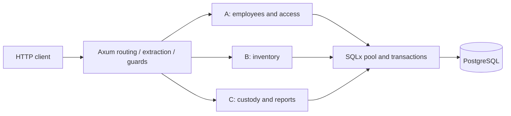
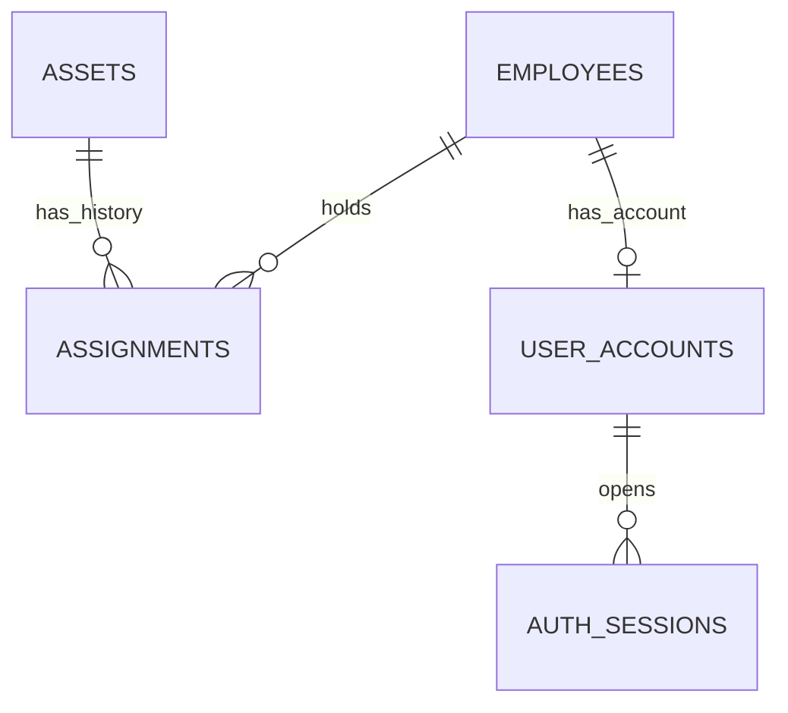

# Architecture, contracts and decisions

Status: design baseline for review; current B implementation is identified
separately from proposed A/C/access integration.

## Structure

One Rust executable contains three domain services. They are not independent
microservice deployments. B's runnable shell supports later route integration.
Startup loads configuration/logging, connects, migrates, binds and serves.

HTTP DTOs define input/output and validation. Handlers translate HTTP to domain
operations. Repositories/services execute bound queries and coordinate rules.
Calculations such as clearance are pure functions with an explicit reporting time.

## Data relationships

B baseline creates employees/assets/assignments. User accounts/sessions describe
A's access extension and are not in the standalone B migration. Existing SQL
migrations are authoritative for actual columns/constraints; proposed design
alone does not create tables.

Core states: employee active/inactive; asset in_service/maintenance/retired;
assignment outstanding if returned_at is null, otherwise returned. Access adds
admin/user roles and enabled accounts. Availability/clearance are derived.

## HTTP contract

Business routes use /api/v1. Implemented B endpoints are create/list/get/PATCH
assets, /health, /ready and /api-docs/openapi.json. The README's complete endpoint
inventory also contains planned A/C routes; those are not operational yet.

Create returns 201 and Location. Missing record gives 404; duplicate/conflicting
state 409; invalid data 422; malformed request 400; unsupported media 415;
oversized JSON 413; unexpected failure 500; DB unavailable 503. Access adds 401,
403 and bounded-auth-work 429. Use consistent JSON without internal SQL/secrets.

Queries bind values and allowlist SQL sort identifiers. B collections use literal
case-insensitive name/tag search, stable ID tie breaks and bounded pagination.
PATCH omission preserves values; null for non-nullable fields is rejected.

## Transaction and ownership contracts

- Operations needing multiple custody rows lock employee -> asset -> assignment.
- Issue locks employee and asset, rechecks activity/availability and inserts the
  assignment. The partial unique index is the final duplicate-open-custody guard.
- B status updates lock the asset and then inspect open custody; rejected status
  and accompanying metadata changes roll back together.
- Return rechecks outstanding state/version; records return/condition/version and
  damaged-return maintenance atomically. Returning an inactive borrower's item is valid.
- A's guards resolve current session/account/employee state. Admin manages global
  records; self-service SQL binds authenticated employee ID. Header/client roles
  cannot authorize operations. Employee deactivation must integrate revocation
  and last-usable-admin policy with the access owner.
- Keep transactions short and hash passwords before taking DB locks.

See [B's detailed transaction contract](../B_DATABASE.md#transaction-contract-for-a-and-c).

## Decision register

| ID | Decision | Reason and tradeoff |
| --- | --- | --- |
| ADR-01 | Modular application with one PostgreSQL database | Small team can share transactions and deployment; boundaries require shared-file coordination |
| ADR-02 | SQLx + migrations + database constraints | Reviewable SQL and shared concurrency guarantees; schema changes need coordination and real DB tests |
| ADR-03 | Derive availability/clearance | Avoid independently editable flags; results are snapshots of recorded custody |
| ADR-04 | Retain history and deactivate/retire | Preserve handovers; collections/indexes account for old records |
| ADR-05 | Opaque bearer sessions/Argon2id access design | Explicit server-side expiry/revocation; adds DB lookup and auth lifecycle work; not implemented by B alone |
| ADR-06 | Typed errors and generated OpenAPI | Consistent clients/review; documentation must match routes and does not itself enforce rules |

These capture known decisions retrospectively. Original decision dates and
formal approvals were not recorded. New decisions should include context,
alternatives, impact, owner/reviewer and the implementing PR/change ID.
