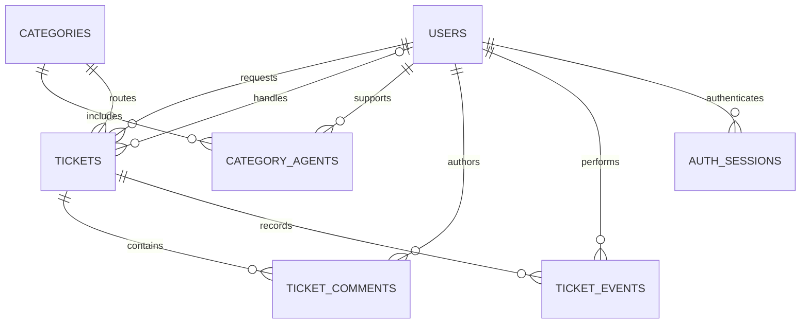

# Ticketing design proposal

Status: planned, 2026-11-17. See [requirements](REQUIREMENTS.md) for acceptance
and [delivery](DELIVERY.md) for ownership. The working tree contains plans and
PostgreSQL configuration only; old application code, manifests, migrations,
tests and CI have been removed. Git history and existing PostgreSQL data/volume
are preserved. New migration startup needs an explicit compatibility decision.

The [short-notice profile](SHORT_NOTICE_DESIGN.md) selects a five-table prototype.
Comments, admin reassignment, advanced queries and authentication below remain
part of the broader target rather than the first milestone.

## Architecture and module ownership

Keep one deployable application and one PostgreSQL database. Service-wise
ownership means Rust modules, not separately deployed microservices.

```text
src/
  main.rs, app.rs, config.rs, state.rs, db.rs, error.rs, telemetry.rs
  auth/           # A: authentication context, sessions and guards
  features/
    users/        # A: dto, model, repository, service, routes
    categories/   # B: dto, model, repository, service, routes
    tickets/      # C: dto, model, repository, service, routes
  openapi.rs      # coordinated exports; each owner documents their routes
migrations/       # additive, ordered; one owner per migration
tests/            # each service plus integrated scenarios
```

This tree describes future work; none of these application files exist yet.
Bootstrap and review the shared foundation first. Keep validation and lifecycle
rules in functions that do not depend on HTTP/SQL. Route handlers extract
validated inputs/context, services enforce policy, repositories perform bound
SQL and transactions. Rust ownership does not replace database concurrency
control across simultaneous requests or multiple application instances.

## Proposed data model

| Table | Key fields and constraints | Owner |
| --- | --- | --- |
| users | UUID PK; name; normalized unique email; role employee/agent/admin; account_status active/inactive; timestamps. Password hash added with authentication. | A |
| categories | UUID PK; unique normalized name; description; is_active flag; created_at/updated_at | B |
| category_agents | Composite PK(category_id, user_id); FKs to categories/users; joined_at | B |
| tickets | UUID PK; requester_id; category_id; nullable assignee_id; subject; description; status; priority; positive version default 1; created_at/updated_at | C |
| ticket_comments | UUID PK; ticket_id; author_id; body; created_at | C |
| ticket_events | UUID PK; ticket_id; actor_id; event_type; optional from/to state and assignee; optional explanation; created_at; resulting_version for state changes | C |
| auth_sessions | Session digest; user FK; expiry/revocation timestamps; never store raw session tokens | A, authentication increment |

Use timestamptz and FK restrictions that preserve referenced users, categories
and ticket history. A unique index on a trimmed/lowercased category key prevents
case-only duplicates. Add indexes for requester/status/created time,
category/status/created time and assignee/status. Comments/events use
(ticket_id, created_at, id) for deterministic reads.



Each ticket has exactly one requester and category and at most one assignee.
An agent can support multiple categories. A ticket starts unassigned in its
category queue; there is no automatic round-robin or rules engine. An empty
support queue remains visible to admins for staffing/assignment.

Cross-table checks require transactional service rules: an assignee must be an
active agent with membership in that ticket's category. Foreign keys alone do
not prove eligibility. Recheck eligibility when starting/resolving work.

## Planned HTTP surface

All routes below are proposals, not currently available endpoints.

| Owner | Method and route | Behavior |
| --- | --- | --- |
| A | POST /api/v1/users | Admin creates an account |
| A | GET /api/v1/users, GET /api/v1/users/{id} | Authorized user directory/details |
| A | PATCH /api/v1/users/{id} | Admin updates metadata, role or active status |
| A | POST /api/v1/auth/login, POST /api/v1/auth/logout | Authentication increment |
| A | GET /api/v1/me | Authenticated identity |
| B | POST /api/v1/categories | Admin creates category |
| B | GET /api/v1/categories, GET /api/v1/categories/{id} | Category discovery; inactive records restricted as documented |
| B | PATCH /api/v1/categories/{id} | Admin updates name/description/active state |
| B | GET /api/v1/categories/{id}/agents | Admin/category agents inspect support membership |
| B | PUT /api/v1/categories/{id}/agents/{user_id} | Admin adds membership idempotently |
| B | DELETE /api/v1/categories/{id}/agents/{user_id} | Admin removes membership if assignment rules allow |
| C | POST /api/v1/tickets | Requester raises ticket |
| C | GET /api/v1/tickets, GET /api/v1/tickets/{id} | Scoped queries/detail |
| C | POST /api/v1/tickets/{id}/claim | Eligible agent claims open/unassigned ticket |
| C | PUT /api/v1/tickets/{id}/assignment | Admin assigns/reassigns/unassigns where allowed |
| C | PATCH /api/v1/tickets/{id}/status | Validated status transition |
| C | POST /api/v1/tickets/{id}/comments | Add employee-visible comment |
| C | GET /api/v1/tickets/{id}/comments | Scoped, paginated conversation |
| C | GET /api/v1/tickets/{id}/events | Scoped, paginated history |

User-directory reads are admin-only in the initial target; employees use /me.
Agents discover support colleagues through their permitted membership endpoint.
Active category names are available to all authenticated users; admin may
include inactive categories. Agents can still handle existing tickets in their
inactive categories. No public signup or self-selected elevated roles.

POST ticket target body:

```json
{
  "category_id": "<Infra category UUID>",
  "subject": "Laptop charger not working",
  "description": "The charger no longer powers my company laptop.",
  "priority": "medium"
}
```

Requester ID is taken from the authenticated context in the target application.
Claim takes expected_version; assignment takes assignee_id (nullable when
allowed) and expected_version. A status update takes status, expected_version
and an explanation when resolving/reopening. Unknown fields are rejected.

State/assignment mutations increment the version exactly once. A stale
expected_version returns 409 with a safe retry message. Comment appends do not
increment that state version; they create their comment and corresponding event
in one transaction. A partial unique constraint/index on (ticket_id,
resulting_version) for non-null versions prevents duplicate state-version events.
Event explanations may contain sensitive information and share the ticket's
access rules. Closed tickets reject further changes/comments. Initial ticket
metadata is immutable; metadata editing is outside this increment.

Lists default to limit 20, maximum 100, offset 0 and created_at descending with
ID tie-breaker. Bind every filter/search value and whitelist sortable columns.
Apply visibility predicates before search, pagination or counts. Never fetch
all tickets and filter a page in application memory.

## Transactions and concurrency contract

Serialize cross-service writes affecting support eligibility with a PostgreSQL
transaction-level advisory lock using one documented application-specific key.
This simple initial design favors correctness over write throughput; replace
it with reviewed finer-grained locking only if measurements justify it.

The shared lock is required for user role/deactivation, membership changes,
category activation changes, ticket creation, claims, assignment and status
transitions. Acquire it before locking affected user/category/membership/ticket
rows; never acquire it after taking those row locks. All owners must follow the
same order. Ordinary reads and comment appends do not take this global lock.

For a claim transaction:

1. Acquire the shared eligibility lock and lock the target ticket row.
2. Recheck caller access, user status, category membership, open state,
   unassigned state and expected_version inside the transaction.
3. Set assignee, increment version, update timestamp and insert a claim event.
4. Commit together. A second competing claim sees the committed assignee or
   changed version and returns 409; it must not insert a successful claim event.

Category deactivation blocks new ticket creation while existing work continues.
Membership removal and any user role/status change removing eligibility check non-closed assignments
under the same eligibility lock. This closes check-then-write races between
A/B configuration changes and C assignment operations.

Ticket transitions and their history must commit atomically. A failed validation
or event insert must roll back the state/assignment change. Comment transactions
lock the ticket row, recheck access and closed state, and insert comment plus
event together. They never acquire the shared eligibility lock afterward. This
allows serialization with closure without reversing the shared lock order.

No local Mutex alone can enforce these rules across application processes.
An authorization transaction must also respect the final session revocation
contract selected by A; cached roles must not silently bypass deactivation.

## Foundation and migration plan

Bootstrap a new Rust manifest and shared configuration, pool/startup, error
shape, readiness, tracing, CI and test fixtures. Historical implementation can
be inspected through Git, but is not present or assumed reusable in this tree.

Before startup applies migrations, inspect the selected database and record the
compatibility approach. A separate empty development database is the preferred
new baseline; an existing database may retain historical SQLx migration records
and cannot simply be treated as empty. Preserve its data/volume and do not
silently reset it or bypass migration validation.

Author ordered users -> categories/membership -> tickets/history migrations
for the agreed baseline. B coordinates names/order; A/C author their own SQL.
Do not convert old inventory rows into tickets. Once the new baseline has been
applied, keep its migrations immutable and add later changes as new migrations.
Update runtime OpenAPI only alongside working handlers.
