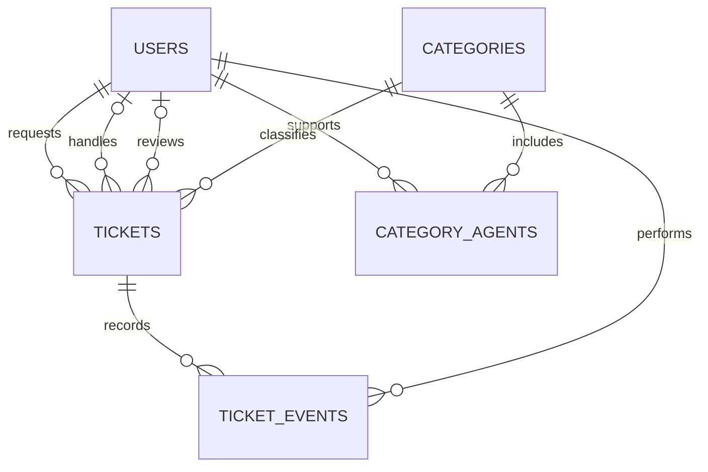

# IT support ticketing design

Status: planned, 2026-11-17. This document defines the revised manager-led
workflow. Shared repository content is documentation; B has reported creating
and checking a local Rust scaffold. No shared ticketing API or database workflow
is implemented. Preserve that local work while changing documentation.

See [requirements](REQUIREMENTS.md), [team tasks](TEAM_TASKS.md) and
[delivery](DELIVERY.md) for acceptance, ownership and implementation order.

## Architecture and ownership

Use one Rust application and one PostgreSQL database. A, B and C own feature
modules within that application, not three independently deployed services.

```text
src/
  main.rs, app.rs, config.rs, state.rs, db.rs, error.rs, telemetry.rs
  auth/                   # A: later sessions and authenticated actor extraction
  features/
    users/                # A: dto, model, service, repository, routes
    categories/           # B: dto, model, service, repository, routes
    tickets/              # C: dto, model, service, repository, routes
  openapi.rs               # each owner contributes implemented contracts
migrations/                # ordered SQL; service owners author their migrations
tests/                     # unit, real-PostgreSQL and integrated scenarios
```

Requests flow through actor extraction, DTO validation, pure domain rules,
service orchestration, bound SQL/transactions and consistent JSON responses.
Use Rust enums for roles/type/priority/status, Option for pending review and
assignment, and Result for domain failures. Ownership does not coordinate
simultaneous database requests; PostgreSQL enforces shared write consistency.

## Five-table business model

| Table | Proposed fields and constraints | Owner |
| --- | --- | --- |
| users | id UUID PK; name; normalized unique email; role employee/it_manager/it_member; account_status active/inactive; timestamps | A |
| categories | id UUID PK; ticket_type service_request/incident; name; description; is_active; timestamps; unique normalized name within ticket_type | B |
| category_agents | Composite PK(category_id, user_id); FKs to categories/users; joined_at; only eligible it_members added through service rules | B |
| tickets | id UUID PK; unique immutable ticket_number; requester_id; ticket_type; category_id; subject; description; status; nullable priority/assignee_id/reviewed_by/reviewed_at; nullable resolution/root_cause; positive version default 1; timestamps | C |
| ticket_events | id UUID PK; ticket_id; actor_id; event_type; applicable old/new status, priority, assignee and review values; resolution/root_cause/explanation snapshots; resulting_version; created_at | C |

Use timestamptz and restrictive FKs that preserve referenced records/history.
Category names are unique ignoring case within their type, not globally.
Tickets must reference a category with the same ticket_type; a composite FK from
(category_id, ticket_type) to a unique categories(id, ticket_type) can enforce it.
Category type and ticket requester/type/category/subject/description are immutable
in this milestone. Reject subcategory_id and other unrecognized creation fields.

New tickets are open/unassigned/unreviewed, with priority, review stamps and
resolution/root cause null. Reviewed fields are paired; an assignment requires
a priority and completed review. Reopening clears assignment/review/resolution
fields but retains the last priority. A pending review therefore cannot be
identified by testing priority IS NULL alone.

Check valid enums, positive versions, bounded trimmed text and resolution
requirements. A resolved/closed incident requires root_cause and resolution;
a service request requires resolution, with root_cause optional. Open and
in-progress work has null current resolution/root cause. Preserve previous
values in events.



Index requester/status/created time, pending review/created time, category/status
and assignee/status. Event queries need ticket_id/created_at/id and previous/new
assignee lookup support. Require one event per (ticket_id, resulting_version)
for committed ticket mutations, including the version-1 creation event.

## Ticket references and category membership

UUIDs remain internal PK/FKs and endpoint identifiers. Expose ticket_number for
human communication, such as SR1001 or INC1001. Generate it from a per-type
PostgreSQL sequence, prefix by immutable ticket_type and enforce uniqueness.
Sequences are database objects, not an extra business table. Never use MAX+1;
rollback may leave sequence gaps, and gap-free numbering is not a requirement.

The first milestone uses flat, type-aware categories. A category can have many
it_members, and a member can support several categories. P1 handling is a
separate manager rule; IT Managers do not need category_agents membership.
Category deactivation blocks new requests but existing tickets can continue.

Later subcategories can use parent_id in categories and a ticket subcategory
reference: one level, same type, root-category membership inherited by children.
Those fields, hierarchy checks and endpoints are deferred. Comments and sessions
also need later storage and contracts; they are not part of the five tables.

## Planned HTTP contracts

All routes are proposals until handlers, tests and OpenAPI are implemented.
Manager operations require an active it_manager actor. A local controlled demo
actor can test policy but does not establish authenticated employee identity.

| Owner | Method and route | Purpose |
| --- | --- | --- |
| A | POST /api/v1/users; GET /api/v1/users; GET /api/v1/users/{id} | Manager-managed user creation/directory/details |
| A | PATCH /api/v1/users/{id} | Manager-managed metadata, role and status changes |
| B | POST /api/v1/categories; GET /api/v1/categories; GET /api/v1/categories/{id} | Type-aware category management/discovery |
| B | PATCH /api/v1/categories/{id} | Manager changes name/description/active flag, not type |
| B | GET /api/v1/categories/{id}/agents | Permitted support-membership read |
| B | PUT or DELETE /api/v1/categories/{id}/agents/{user_id} | Manager adds/removes eligible it_members |
| C | POST /api/v1/tickets; GET /api/v1/tickets; GET /api/v1/tickets/{id} | Request creation and scoped collection/details |
| C | POST /api/v1/tickets/{id}/review | Manager atomically reviews, prioritizes and assigns pending work |
| C | PATCH /api/v1/tickets/{id}/status | Assigned handler starts/resolves; requester confirms/reopens |
| C | GET /api/v1/tickets/{id}/events | History under current ticket visibility |
| C | GET /api/v1/me/work-history | Current actor's minimal historical work records |

Creation accepts ticket_type, category_id, subject (1..160 characters) and
description (1..8,000). Derive requester identity from the actor context. Reject
client-supplied ticket_number, priority, assignee, review stamps or resolution.
The manager review body supplies authoritative priority and expected_version:

```json
{
  "priority": "p2",
  "assignee_id": "<active supported IT Team Member UUID>",
  "expected_version": 1
}
```

For P1, derive assignee_id from the acting manager; if a client supplies that
field, require the same actor ID. P2/P3/P4 require assignee_id for an active
it_member with category membership. Review accepts only open/unassigned tickets
with cleared review stamps. Set priority, assignee and reviewed_by/at together,
increment once and record one reviewed_and_assigned event. Status stays open.
There is no initial self-claim endpoint or independent assignment mutation.

Status bodies contain status and expected_version. Resolving also requires a
trimmed nonblank resolution (maximum 8,000 characters); incidents require
root_cause (maximum 4,000). Reopening requires explanation (maximum 4,000).
Reject unsupported transitions, fields, nulls and out-of-bound values.

Successful creates return 201 plus Location, reads/state changes 200 and
membership PUT/DELETE 204. Map malformed input to 400, validation to 422,
missing/invisible resources to 404 and visible business/version conflicts to
409. Use 413/415 for body-size/content-type errors; authentication adds 401/403.
Keep safe shared 500/503 errors; do not return raw SQL, credentials or private
diagnostic data.

Ticket lists support ticket_type, category_id, status, priority and reviewed
filters. reviewed=false selects the manager's pending open review queue by
cleared review stamps/assignment. Bound pagination: default limit 20, maximum
100, nonnegative offset default 0; created_at sort with stable ID tie-breaker.
Apply visibility in SQL before filters, sorting, pagination or any future count.

## State, confirmation and history

| From | To | Permitted actor and precondition |
| --- | --- | --- |
| open | in_progress | Current assigned handler; completed review and valid priority/assignee eligibility |
| in_progress | resolved | Current assigned handler; required resolution/root cause |
| resolved | closed | Original requester confirms, including P1 |
| resolved | open | Original requester supplies a reopening reason |

Managers handle their own assigned P1 work; they cannot start/resolve another
handler's work or close a P1 ticket on the requester's behalf. A manager may
confirm closure when also the original requester. resolved means “Awaiting
employee confirmation”; closed means requester-confirmed completion.

Reopening clears assignee_id, reviewed_by/at, resolution and root_cause; retains
priority; increments version and records all old values plus the reason. The
open ticket returns to manager review. Closed tickets are final/read-only.
No timeout automatically closes a ticket. Creation, review, start, resolution,
confirmation and reopening each produce an atomic immutable history event.

## Visibility and work history

Employees see their own requests. IT Managers oversee IT tickets only; HR is
outside this initial domain and needs a separate access boundary if added.
IT Team Members see currently assigned tickets and their own requests, not an
entire category queue. All roles retain requester rights on their own tickets.

Former handlers can read their own minimal work-history projection from events:
ticket UUID/number, assignment dates and their own historical actions/statuses.
This does not grant access to current full-ticket contents, other employees'
identity, later resolution details or another handler's activity. Ticket event
endpoints retain the same current-visibility check as ticket details. Use the
server actor for /me; do not accept a caller-selected user ID as authorization.

## Transactions and concurrency contract

Centralize one PostgreSQL transaction-level advisory lock for eligibility writes.
Acquire it before affected user/category/membership/ticket row locks. It covers
user eligibility changes, category activation, membership changes, ticket
creation, review and state changes. This serializes those writes in the small
prototype; it is not a high-throughput performance claim.

Manager-review transaction:

1. Acquire the shared lock, lock the ticket and recheck actor/activity/visibility.
2. Check open/unassigned/unreviewed state and expected_version; do not require
   priority null because reopened work retains it.
3. Validate requested priority and the P1 manager or P2–P4 member eligibility.
4. Set review/assignment together, increment version once and insert one event.
5. Commit all or roll back all. Two overlapping reviews produce one success,
   one 409 and one successful review event.

Recheck assignment eligibility when starting/resolving. Membership removal and
any role/status change that invalidates a current non-closed assignment return
409 under the same lock. This includes either direction between it_manager and
it_member where the ticket's priority requires the previous role. P1 manager
eligibility does not depend on membership. The requester must confirm closure
or reopen to clear the outstanding assignment before eligibility is removed;
reassignment is a later command. Resolving alone leaves a non-closed assignment.

Later reprioritization/reassignment must be one versioned manager command that
revalidates the entire priority/assignee rule and appends an event atomically.
A Rust Mutex alone cannot protect these invariants across application processes.

## Verification and foundation order

Test type/category matching, duplicate names within a type, number uniqueness
under concurrent creation, correct prefixes, role/priority assignment rules,
concurrent manager review, stale versions, event-write rollback, configuration
change/review races, resolution requirements and requester-only confirmation.
Prove reopening clears current review/resolution fields but preserves priority
and immutable history. Later authenticated tests cover scope leaks and revoked
sessions, including the former-handler history boundary.

Bootstrap shared configuration/runtime/logging/errors/OpenAPI/CI and fixtures
through the agreed reviewed foundation PR. Use only committed migrations for the
chosen baseline: users -> categories/membership -> tickets/events and sequences.
Inspect retained database/SQLx history first; prefer a separate empty development
database or a reviewed compatible path, preserving old data/volumes. Keep
applied migrations immutable. A/B configuration guards require C's ticket schema.
