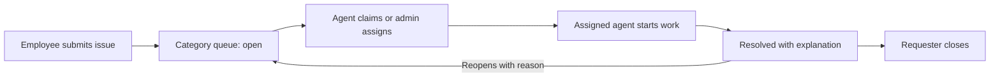

# Internal company support system: team implementation handoff

Prepared 2026-11-17. Final project name pending. This is an implementation
blueprint and team briefing, not a claim that the ticketing API is built.

For the selected first milestone, start with the
[short-notice design and P1–P6 learning map](SHORT_NOTICE_DESIGN.md). It selects
five tables and defers comments, admin reassignment, advanced queries and
authentication. This handoff also describes the broader target/follow-up work.

## 1. The application in one paragraph

Employees raise company support requests under categories such as Infra and
HR. Each category has support agents. An eligible agent claims a request, works
on it, records a resolution and lets the employee confirm closure or reopen it.
An admin manages users, categories and agent membership, and can assign work.
The company gains a visible queue, a responsible person and a recorded outcome
instead of relying on scattered conversations.

Example: “My laptop charger is not working” becomes an Infra ticket; “Please
correct my attendance record” becomes an HR ticket. The application tracks
these requests; it does not itself repair hardware or change payroll records.

## 2. Current state versus target

| Item | State at this handoff |
| --- | --- |
| Base branches | main and develop; see BRANCHING.md for the service branches |
| Current remote develop | Earlier documentation baseline; does not yet contain the Rust foundation |
| Local planning branch | docs/support-ticketing-plan in AssetDesk-B |
| Working baseline | Markdown ticketing plans and review templates only |
| Rust application/manifests | Removed with the old implementation; a new foundation must be bootstrapped |
| Compose/environment/ignore configuration | Absent; future foundation work must create it |
| Migrations/tests/CI | Old files removed; new ticketing setup is planned |
| PostgreSQL data/volume | Preserved; choose database compatibility before applying a new baseline |
| New A/B/C implementation branches | Created from origin/develop; see BRANCHING.md for synchronization |

First bootstrap and review a new foundation PR into develop; then start feature
branches from that shared base. The old implementation was removed from the
working tree; Git history remains available for reference. There is no current
Rust manifest, executable, Compose/environment setup, test suite or CI pipeline
to run. Existing service branches should synchronize through the reviewed
documentation baseline and then the new foundation in develop.

The file cleanup does not stop existing database containers or delete external
data/volumes. Database names remain an operator decision while naming is undecided.
Before applying new migrations, record a separate empty development database
or an explicitly reviewed compatibility approach. Existing databases may retain
old schema and SQLx migration records. Do not delete their data/volume or treat
them as empty because migration files were removed from the repository.

## 3. Scope and actors

| Actor | Responsibilities |
| --- | --- |
| Employee | Raise own tickets, view progress, comment, close or reopen a resolved ticket |
| Support agent | See tickets in assigned categories, claim eligible work, update assigned tickets and resolve them |
| Admin | Manage users/categories/membership, assign/reassign tickets and oversee all queues |

An agent can support several categories and can also raise their own ticket.
Employee department and support category are different concepts: an employee
from any department may request Infra or HR support.

Employees see only their tickets. Agents additionally see their category queues.
An Infra-only agent cannot see another employee's HR request. Admin has global
visibility in this initial design. The same restrictions apply to details,
search, pagination, counts, comments and history.

Build first: users, categories, memberships, ticket create/read/list,
claim/assignment, lifecycle and history. Add comments when the core is stable.
Company use also requires working authentication and authorization.

Defer: frontend, email ingestion, notifications, attachments, SLA automation,
approval flows, private staff notes, category transfers, payroll computation,
AI features and a full ServiceDesk Plus feature set.

## 4. End-to-end employee workflow

1. Admin creates users, active categories and category-agent memberships.
2. Employee signs in in the authenticated target application.
3. Employee chooses an active category and submits subject, description and
   priority. The server supplies requester ID, open status, timestamps and
   version 1. The ticket starts unassigned.
4. The ticket appears in that category's queue. It stays unassigned until an
   eligible agent claims it or admin assigns an eligible agent.
5. The assigned agent starts work, changing open to in_progress.
6. Requester and authorized support staff exchange employee-visible comments.
7. Assigned agent resolves the ticket with an explanation.
8. Requester closes it if satisfied, or reopens it with a reason. Reopening
   clears the assignee and returns it to the category queue.
9. All state/assignment changes retain actor, timestamp and event history.



Claiming does not automatically start work. There is no automatic timeout that
closes a ticket. Closed tickets are read-only in this increment. Category,
requester, original subject/description and priority are immutable initially;
comments provide additional information. Metadata editing can be a later story.

Example state/version sequence:

| Action | Result | Version |
| --- | --- | --- |
| Employee creates | open, unassigned | 1 |
| Agent claims with expected_version 1 | open, assigned | 2 |
| Assigned agent starts with expected_version 2 | in_progress | 3 |
| Employee adds a comment | in_progress; comment/event appended | 3 |
| Assigned agent resolves with expected_version 3 | resolved | 4 |
| Employee closes with expected_version 4 | closed | 5 |

Alternatively, reopening version 4 produces open/unassigned version 5.
Old resolutions remain in history rather than being overwritten.

## 5. Technology and request processing

Use Rust, Tokio, Axum, SQLx, PostgreSQL, Serde/JSON, tracing and Utoipa/OpenAPI.
Keep one application and one database with three module owners.

```text
HTTP request
  -> authenticated actor extraction and route guard
  -> DTO parsing/validation
  -> service permission and business rules
  -> SQLx repository and PostgreSQL transaction
  -> DTO response or consistent AppError
```

Model role, status and priority with Rust enums; use Option for an unassigned
agent and Result for failures. Keep normalization and status-transition rules
pure so they can be tested without an HTTP server. Async functions wait for
HTTP/DB I/O through Tokio; they do not need a new OS thread per request.
Use the database to coordinate concurrent updates across requests/processes.

Proposed future layout to bootstrap:

```text
src/
  main.rs                 # configuration, startup, shutdown
  app.rs                  # router composition and shared middleware
  config.rs               # validated configuration
  db.rs                   # pool and committed migrations
  state.rs                # shared application state
  error.rs                # common HTTP error mapping
  telemetry.rs            # structured logging
  openapi.rs              # documented implemented routes/schemas
  auth/                   # A: sessions, actor extraction and guards
  features/
    users/                # A
    categories/           # B
    tickets/              # C
      mod.rs
      dto.rs
      model.rs
      service.rs
      repository.rs
      routes.rs
migrations/
tests/
  users.rs
  categories.rs
  tickets.rs
  support_workflow.rs
  common/mod.rs
```

Each feature uses the same dto/model/service/repository/routes pattern shown
under tickets. Models describe domain/database values; DTOs describe external
requests/responses. Avoid returning password hashes/session digests in a user DTO.

## 6. Database design and ownership: broader target

| Table | Fields | Owner |
| --- | --- | --- |
| users | id UUID PK, name, normalized unique email, role, account_status, created_at, updated_at; password_hash with auth increment | A |
| categories | id UUID PK, name, description, is_active, created_at, updated_at; unique normalized name | B |
| category_agents | category_id FK, user_id FK, joined_at; composite PK(category_id, user_id) | B |
| tickets | id UUID PK, requester_id FK, category_id FK, assignee_id nullable FK, subject, description, status, priority, version, created_at, updated_at | C |
| ticket_comments | id UUID PK, ticket_id FK, author_id FK, body, created_at | C |
| ticket_events | id UUID PK, ticket_id FK, actor_id FK, event_type, nullable old/new state and assignee, explanation, nullable resulting_version, created_at | C |
| auth_sessions | session digest, user_id FK, expires_at, revoked_at, created_at | A, authentication increment |

Use timestamptz. Constrain role/status/priority values, positive ticket version,
nonblank bounded text and FK relationships. Preserve referenced users/categories
through deactivation rather than deletion. Use a case-insensitive unique
category-name key; match the relevant unique constraint when returning 409.

Indexes support requester/category/assignee plus ticket status and creation
time. Comments/events use ticket_id, created_at and id for deterministic reads.
State-change event versions should be unique per ticket; comment events do not
consume a state version.

Migration order: users -> categories/membership -> tickets/comments/events ->
authentication additions. B coordinates names and dependencies; each owner
writes/reviews the SQL for their service. Assignment guards that query tickets
must not be advertised as complete before C's migration is available.

## 7. A/B/C implementation tasks and functions: broader target

| Owner | Deliverables | First small PR |
| --- | --- | --- |
| A | User CRUD/list/deactivation, login/session lifecycle, actor extraction, role guards and user eligibility | User migration, DTOs and CRUD with real-DB tests |
| **B: Shreyas** | **Foundation coordination, categories, activation/deactivation, category-agent membership and shared eligibility contract** | **Category create/get/list, validation and unique-name tests** |
| C | Ticket create/get/list, claim/admin assignment, state transitions, comments and event history | Ticket migration/create/get/list using A/B contracts |

Suggested function responsibilities; these are names/contracts to implement,
not existing callable functions:

| Module | Function | Responsibility |
| --- | --- | --- |
| A | validate_user_input | Pure normalization/bounds; reject invalid roles/status |
| A | create_user / update_user / list_users | User persistence and admin operations |
| A | deactivate_user | Reject outstanding non-closed assignments, deactivate and revoke sessions atomically |
| A | current_actor / require_admin | Derive active user/role from a validated session and enforce access |
| B | validate_category_input | Pure trimming/name/description validation |
| B | create_category / update_category / list_categories | Category persistence, filters and duplicate handling |
| B | add_agent / remove_agent / list_agents | Membership eligibility/idempotency and removal guards |
| B/C | is_eligible_agent | In the caller's transaction, verify active agent plus category membership |
| C | create_ticket / get_ticket_scoped / list_tickets_scoped | Valid creation and visibility applied in SQL |
| C | claim_ticket / assign_ticket | Locked, versioned assignment with an event |
| C | validate_transition | Pure allowed-state/explanation validation |
| C | change_status | Actor policy, eligibility, version and event in one transaction |
| C | add_comment / list_comments / list_events | Visibility and conversation/history persistence |

Document shared helpers before another owner imports them. Avoid helpers that
start an unrelated transaction when the caller already needs atomic changes.
App/router/error/OpenAPI/Cargo.lock changes need one coordinated integrator.

## 8. Planned APIs: broader target

These endpoints are **future contracts**. No application server exists in this
working tree yet. All target routes use /api/v1 and the shared JSON error shape.

| Service | APIs |
| --- | --- |
| A users | POST /users; GET /users; GET /users/{id}; PATCH /users/{id} |
| A auth | POST /auth/login; POST /auth/logout; GET /me |
| B categories | POST /categories; GET /categories; GET /categories/{id}; PATCH /categories/{id} |
| B membership | GET /categories/{id}/agents; PUT and DELETE /categories/{id}/agents/{user_id} |
| C tickets | POST /tickets; GET /tickets; GET /tickets/{id} |
| C assignment | POST /tickets/{id}/claim; PUT /tickets/{id}/assignment |
| C lifecycle | PATCH /tickets/{id}/status |
| C conversation/history | POST and GET /tickets/{id}/comments; GET /tickets/{id}/events |

Users directory/write operations are admin-only. All authenticated users can
discover active categories. Membership lists are limited to admin and agents
in that category. Agents can continue working on existing tickets after category
deactivation. There is no public signup or role selected by a login request.

Ticket lists accept q, category_id, status, priority, assignee_id, sort, order,
limit and offset. Default limit 20, maximum 100; offset is nonnegative. Whitelist
sort fields created_at/updated_at and add an ID tie-breaker. Initial list
responses use items, limit and offset; omit total counts unless needed/tested.

Planned create-ticket body:

```json
{
  "category_id": "<Infra category UUID>",
  "subject": "Laptop charger not working",
  "description": "The charger no longer powers my company laptop.",
  "priority": "medium"
}
```

Priority defaults to medium if omitted. Requester ID comes from the server's
actor context. Claim accepts expected_version; assignment accepts assignee_id
and expected_version; state change accepts status, expected_version and an
explanation when resolving/reopening. Reject unknown fields and invalid nulls.

POST creates return 201 plus Location; reads/updates return 200; membership
PUT/DELETE return 204 when successful. Missing membership deletion is idempotent
after checking category/permission rules. Use 400 for malformed requests, 422 for
validation, 401 for missing/invalid session, 403 for a forbidden action on a
visible resource, 404 for missing/invisible tickets, 409 for business/version
conflicts, 413/415 for body/content-type errors and safe 500/503 errors.

## 9. Concurrency and transactional rules

Ticket state and assignment writes take expected_version. Under a transaction,
recheck it, apply the permitted mutation, increment version once and insert the
event. Commit both together or roll both back.

For this small initial implementation, all writes affecting eligibility share
one documented PostgreSQL transaction-level advisory lock. This serializes
those writes, including unrelated tickets; measure before optimizing it.

Acquire that shared lock before row locks for user role/status changes,
category activation changes, membership changes, ticket creation, claims,
assignment and lifecycle transitions. Recheck actor eligibility inside the
transaction. Ordinary reads do not need the shared lock. Comment append takes
the ticket row lock, rechecks visibility/closed state, then inserts comment and
event; it never subsequently acquires the global lock. This serializes append
with closure without introducing the opposite lock order.

Two agents claiming version 1 must produce one successful claim, one 409 and
one successful claim event. A Rust Mutex alone cannot enforce this across
different application processes.

Removing membership or making any role/status change that removes an agent's
eligibility with assigned, non-closed tickets returns 409. This includes
agent-to-admin under the single-role enum. An admin first reassigns
open/in-progress tickets in the full target. Resolved
tickets must first be closed by the requester/admin, or reopened and reassigned;
assignment changes are not supported directly in resolved state.

## 10. Challenges and recovery behavior

| Situation | Application behavior / team action |
| --- | --- |
| Two agents claim together | One commit; other gets 409, refreshes the ticket and sees its assignee |
| Employee submits a stale status change | 409; fetch current version and decide whether the action still applies |
| Duplicate category name with different case | 409; return a safe duplicate-name error |
| Category is inactive | Reject new tickets with 409; keep existing work/history available |
| Category has no available agents | Leave ticket unassigned; admin sees the queue and can add support membership; no ticket is discarded |
| Agent leaves a category or company | Block removal/deactivation until non-closed assigned work is handled |
| Employee is unhappy with a resolution | Reopen resolved ticket with a reason; return it unassigned to the same queue |
| Ticket is closed | Keep it readable; reject further changes/comments with 409; create a new related request manually if needed |
| Employee chose the wrong category | Employee creates a new request in the correct category; support resolves the original as misrouted through the normal lifecycle. Do not copy private HR details into another queue; automatic transfer is deferred. |
| Failure writing an event | Roll back the associated ticket change; never return success for a partial write |
| DB is unavailable | Readiness 503, safe request error, structured operational logs; restore DB before retrying |
| Timeout after a POST | Check whether the ticket was created before manually retrying; automatic idempotent creation is deferred |

Time spent waiting for support does not automatically close a request. SLA
escalation and reminders can become later stories after this workflow works.

## 11. Implementation order and three-day proposal

1. **Shared foundation, T-X00:** B coordinates bootstrapping a Rust manifest and
   runtime/Compose/environment/ignore rules/DB/error/logging/CI/test setup,
   reviewed into develop by A/C.
   Record database compatibility before startup runs new migrations.
2. **Data contracts:** agree user fields, category fields, table/migration names,
   actor type, error codes, pagination and the shared transaction helper.
3. **Independent slices:** A users; B categories; C pure ticket rules/DTOs and
   ticket schema, merging in migration dependency order.
4. **Integration:** membership -> ticket creation -> claim/assignment -> status
   and events. Add comments after the core workflow is stable.
5. **Verification:** real DB/concurrency tests, actual OpenAPI, manual demo and
   teammate review. Mark unmet stories pending rather than hiding them.

| Day | A | B | C |
| --- | --- | --- | --- |
| 1 | User contract, migration, CRUD | Foundation coordination and category CRUD | Ticket DTOs, transition rules and schema |
| 2 | User updates/deactivation; identity contract | Category activation and membership | Ticket CRUD, category queue and claim |
| 3 | Integration/tests and access increment estimate; help C test | B tests, shared schema integration and docs; help C test races | Lifecycle/events |

This schedule includes new foundation work and is not a guarantee. Comments,
advanced queries and reassignment are follow-up work under the selected profile.
Do not defer core transaction/version checks just to show more endpoints.

P6 explicitly advises deferring authentication/authorization, estimating around
a week. User CRUD remains part of the prototype. The company version still
requires the login/role features requested by the owner.

If authentication is deferred for a local coursework demo, A may supply an
explicit demo-only actor adapter for synthetic fixture users. Keep the same
service Actor interface; do not add requester_id/role to production DTOs. Any
demo header is merely an actor selector, not authentication. It must be opt-in,
restricted to a loopback listener, rejected in normal mode and documented as
unable to protect real employee/HR data. Such an adapter does not exist yet.
The company release must use actual sessions and pass access-negative tests.

A's authentication increment must document admin bootstrap, password setup,
hashing off async workers, session expiry/revocation, logout and deactivation.
Never rely on a committed default admin password or trust client-supplied roles.

## 12. Local run and future manual demo

**Current repository:** Markdown documentation only. There is no Compose file,
environment template, Cargo manifest or executable setup to run. Existing
external database containers/data may still exist; their presence does not
supply configuration to this repository.

**Future local setup:** after the foundation creates Compose configuration,
an environment template, suitable ignore rules and the Rust runtime, the
operator can follow commands such as these. They cannot run from today's
documentation-only baseline and are not executed by this document.

```bash
cd /home/technoidentity/Project/AssetDesk-B
test -f .env || cp .env.example .env
docker compose up -d --wait db
docker compose ps db
```

Proposed development addresses: PostgreSQL 127.0.0.1:5434 and API
127.0.0.1:3000; define them in future configuration. `cargo run`, health/readiness
requests and Cargo tests are future steps after bootstrapping. Choose the
database/migration compatibility strategy before startup.

**Future authenticated ticketing demo:** after implementation, fixtures/bootstrap
must provide admin, requester and Infra-agent sessions plus category membership.
A should document secure handling of tokens; do not paste them into PR evidence.
Then demonstrate these planned calls with the appropriate actor's session:

```text
admin:      POST /api/v1/categories              -> Infra category
admin:      PUT /api/v1/categories/{id}/agents/{agent_id}
requester:  POST /api/v1/tickets                 -> open, version 1
agent:      POST /api/v1/tickets/{id}/claim      -> assigned, version 2
agent:      PATCH /api/v1/tickets/{id}/status    -> in_progress, version 3
agent:      PATCH /api/v1/tickets/{id}/status    -> resolved, version 4
requester:  PATCH /api/v1/tickets/{id}/status    -> closed, version 5
requester:  GET /api/v1/tickets/{id}/events      -> retained history
```

Use xh for requests and jq for extracting IDs/versions from JSON. In xh use
key=value for strings, key:=value for numbers/booleans and key==value for query
parameters; no space after equals. Supply a current expected_version each time.
These future calls cannot run until the ticketing server is implemented.

## 13. Tests and P6 evidence

| Concept | Demonstration |
| --- | --- |
| Resource/HTTP design | Clear users/categories/tickets resources, 201/Location, error/status semantics |
| Relationships and validation | Membership, active users/categories, valid assignment and bounded inputs |
| Serde and types | DTOs, role/status/priority enums, Option and Result |
| Async | Axum handlers and SQLx DB waits under Tokio |
| SQL/database design | Migrations, FK/unique/check constraints and bound queries |
| Concurrency | Overlapping claim, stale version and config-change/assignment tests |
| Observability | Structured request ID/status/latency logging without ticket bodies/tokens |
| Documentation/testing | Utoipa/OpenAPI, xh/jq demonstration and real-PostgreSQL integration tests |

The alternative domain is proposed under P6's example-project allowance; it is
not a claim that original projects/teams/tasks requirements are literally
implemented unchanged. No numeric grading rubric was inferred from P6.

Required tests include duplicate categories/users, invalid DTOs, inactive
category rejection, invalid membership, one winning concurrent claim, stale
version, rollback on event failure, membership/deactivation races, valid/invalid
status transitions and comment/closure races. Authenticated release tests must
also cover cross-user/cross-category leaks through every nested/list endpoint,
invalid/expired/revoked sessions and deactivated users.

After the Rust manifest, implementation and test suite exist, run these future
checks with a dedicated development/test PostgreSQL account:

```bash
cargo fmt --check
cargo clippy --locked --all-targets -- -D warnings
cargo test --locked
```

The future SQLx tests should create isolated databases; the test account needs
that capability. Never use a company production database for this test suite.
No application tests or CI workflow currently exist, and no ticketing test
results are claimed by this planning baseline.

## 14. Agile documentation, Git workflow and handover

Maintain a board with Backlog -> Ready -> In progress -> Review/Test -> Done.
Each story records owner, acceptance, dependencies, PR, exact-commit checks and
review evidence. Use the company's actual cadence; do not invent past meetings.

Before coding, agree the milestone scope. During work, record blockers and
integration changes. At the review, demonstrate working behavior and capture
feedback. At the retrospective, choose one actionable improvement with an owner.

The following branches already exist locally and on origin. After the reviewed
planning baseline and foundation reach develop, each developer uses a clean
checkout of their branch and normally merges updated origin/develop:

| Member | Branch |
| --- | --- |
| A | feat/support-users |
| B | feat/support-categories |
| C | feat/support-tickets |

Use normal pushes and reviewed feature PRs into develop, then a reviewed release
PR into main. Do not force-push or merge your own work without the agreed review.
Do not run branch-switch commands in a checkout containing someone else's
uncommitted changes. See [BRANCHING.md](BRANCHING.md) for setup/PR state and
[TEAM_TASKS.md](TEAM_TASKS.md) for each service's first implementation slice.

Before company release: record the exact candidate, real DB/access test results,
business acceptance, operator/environment, actual setup and secure admin
bootstrap, known limitations, backup/restore and a migration recovery rehearsal.
No release/ceremony/approval is completed by checking a template into Git.

Related references: [requirements](REQUIREMENTS.md), [design](DESIGN.md),
[detailed delivery/backlog](DELIVERY.md) and [documentation index](../README.md).
